

<a href="https://matiasasin.is-a.dev/"><picture><source media="(prefers-color-scheme: dark)" srcset="assets/hero-dark.svg"/><source media="(prefers-color-scheme: light)" srcset="assets/hero-light.svg"/></picture></a>

<a href="https://matiasasin.is-a.dev/"><picture><source media="(prefers-color-scheme: dark)" srcset="assets/contact-portfolio-dark.svg"/><source media="(prefers-color-scheme: light)" srcset="assets/contact-portfolio-light.svg"/></picture></a>
<a href="https://www.linkedin.com/in/matias-asin-573320250/"><picture><source media="(prefers-color-scheme: dark)" srcset="assets/contact-linkedin-dark.svg"/><source media="(prefers-color-scheme: light)" srcset="assets/contact-linkedin-light.svg"/></picture></a>
<a href="mailto:matiasasin123@gmail.com"><picture><source media="(prefers-color-scheme: dark)" srcset="assets/contact-email-dark.svg"/><source media="(prefers-color-scheme: light)" srcset="assets/contact-email-light.svg"/></picture></a>
<a href="https://wa.me/5491170623866"><picture><source media="(prefers-color-scheme: dark)" srcset="assets/contact-whatsapp-dark.svg"/><source media="(prefers-color-scheme: light)" srcset="assets/contact-whatsapp-light.svg"/></picture></a>

Full stack con criterio de datos, seguridad y operación real, y con una mirada muy exigente sobre el frontend: vengo del diseño gráfico, así que jerarquía, tipografía, espaciado y movimiento son parte del trabajo y no un detalle del final. Arranco desde el problema de negocio y llevo el producto hasta que corre en el piso: interfaz, código, pagos, base de datos, deploy, capacitación al staff y soporte en vivo.

## En producción

<a href="https://miboliche-landing.vercel.app"><picture><source media="(prefers-color-scheme: dark)" srcset="assets/project-miboliche-dark.svg"/><source media="(prefers-color-scheme: light)" srcset="assets/project-miboliche-light.svg"/></picture></a>

<a href="https://www.arbos.ar"><picture><source media="(prefers-color-scheme: dark)" srcset="assets/project-arbos-dark.svg"/><source media="(prefers-color-scheme: light)" srcset="assets/project-arbos-light.svg"/></picture></a>

## En desarrollo

<a href="https://pedilo.net"><picture><source media="(prefers-color-scheme: dark)" srcset="assets/project-pedilo-dark.svg"/><source media="(prefers-color-scheme: light)" srcset="assets/project-pedilo-light.svg"/></picture></a>
<picture><source media="(prefers-color-scheme: dark)" srcset="assets/project-ticketera-dark.svg"/><source media="(prefers-color-scheme: light)" srcset="assets/project-ticketera-light.svg"/></picture>
<picture><source media="(prefers-color-scheme: dark)" srcset="assets/project-inmo-dark.svg"/><source media="(prefers-color-scheme: light)" srcset="assets/project-inmo-light.svg"/></picture>
<picture><source media="(prefers-color-scheme: dark)" srcset="assets/project-ventapro-dark.svg"/><source media="(prefers-color-scheme: light)" srcset="assets/project-ventapro-light.svg"/></picture>
<picture><source media="(prefers-color-scheme: dark)" srcset="assets/project-market-dark.svg"/><source media="(prefers-color-scheme: light)" srcset="assets/project-market-light.svg"/></picture>
<picture><source media="(prefers-color-scheme: dark)" srcset="assets/project-mora-dark.svg"/><source media="(prefers-color-scheme: light)" srcset="assets/project-mora-light.svg"/></picture>

## Seguridad y herramientas internas

<picture><source media="(prefers-color-scheme: dark)" srcset="assets/project-auditoria-dark.svg"/><source media="(prefers-color-scheme: light)" srcset="assets/project-auditoria-light.svg"/></picture>
<picture><source media="(prefers-color-scheme: dark)" srcset="assets/project-bridge-panel-dark.svg"/><source media="(prefers-color-scheme: light)" srcset="assets/project-bridge-panel-light.svg"/></picture>

La mayoría de estos repos son privados porque son productos en operación o de clientes. Si querés ver código o una demo, escribime.

## Cómo trabajo

<picture><source media="(prefers-color-scheme: dark)" srcset="assets/process-dark.svg"/><source media="(prefers-color-scheme: light)" srcset="assets/process-light.svg"/></picture>

- **Frontend cuidado al detalle.** Diseño en Figma y Penpot, y lo llevo a código sin perder jerarquía, tipografía, espaciado ni movimiento.
- **Spec antes que código.** Cada fase arranca con su spec y su criterio de aceptación.
- **Probado antes de salir.** Tests unitarios, tests de base contra Supabase local (RLS, RPC, carreras) y end-to-end con Playwright, con CI.
- **La plata no se rompe.** Montos en enteros, webhooks idempotentes, reservas atómicas y conciliación de pagos.
- **Diseñado para el piso.** Interfaces que usa un barman o una cajera a las 3 de la mañana.

## Stack

<picture><source media="(prefers-color-scheme: dark)" srcset="assets/stack-dark.svg"/><source media="(prefers-color-scheme: light)" srcset="assets/stack-light.svg"/></picture>

<!--STATS:START-->
<!--STATS:END-->

## Formación

- **Tecnicatura Superior en Ciencia de Datos** · Teclab · en curso (etapa final), con título intermedio
- **Mercado Pago Checkout Pro** · certificación oficial, desarrollador certificado
- **Full Stack Web Development** · Egg Cooperation · Backend Java y Frontend React
- **Idiomas** · Español nativo · Inglés profesional

Todo en texto plano

 

Soy **Matías Asin**, Software Engineer full stack de Bolívar, Buenos Aires, Argentina. Trabajo todo el producto, del diseño de la interfaz a la base de datos, con foco fuerte en frontend y diseño gráfico. Remoto, presencial en CABA o con relocación.

**Proyectos**

- **[miBoliche](https://miboliche-landing.vercel.app)**: POS y pedidos por QR para boliches, en producción en Bosko desde julio de 2026. Next.js, SSE, Postgres, Mercado Pago Checkout Pro.
- **[ARBOS](https://www.arbos.ar)**: e-commerce de perfumes con dashboard privado de gestión. Next.js 16, Supabase, GSAP, Playwright.
- **[Pedilo](https://pedilo.net)** (ex Bolívar Pide): delivery local con panel de negocio en tiempo real y bot de pedidos por WhatsApp con IA. Next.js 16, Supabase, Turborepo, Docker.
- **Ticketera QR**: venta y validación de entradas con QR firmado y check-in atómico. Next.js, Supabase, Mercado Pago.
- **Bolívar Inmo**: portal inmobiliario de la ciudad, con mapa. Next.js 16, MapLibre, Supabase.
- **VentaPro**: POS y gestión para kioscos y supermercados. React, Vite, TypeScript, Supabase.
- **Pedilo Market**: marketplace por localidades con pujas en vivo (demo). Next.js 16, React 19.
- **Mora**: gestión de mora y cobranza municipal (demo). Next.js, TypeScript.
- **Auditoría Actual Online**: responsible disclosure y auditoría autorizada, con 22 hallazgos, re-auditoría y plan de remediación.
- **Bridge Panel**: calendario interno del equipo. Vite, React, Motion, Supabase.
- También: [pedilo-landing](https://github.com/Bridge-Bolivar/pedilo-landing), mi [portfolio](https://github.com/Genkaix1000/portfolio), un facturador en Flutter y addons para Garry's Mod.

**Stack**

- **Frontend**: Next.js, React, TypeScript, Tailwind CSS, Motion, GSAP, Vite, Flutter, PWA
- **Backend y datos**: Node.js, Supabase, PostgreSQL, SQL, Row Level Security, Java · Spring, Zod
- **Pagos e integraciones**: Mercado Pago Checkout Pro, Webhooks, SSE, Realtime, WhatsApp Cloud API
- **Testing e infra**: Playwright, Vitest, GitHub Actions, Docker, Vercel, Caddy, Linux, Turborepo
- **Seguridad y redes**: Auditoría de APIs, OWASP Top 10, Auth / RBAC, TCP/IP · DNS, Redes Wi-Fi
- **Diseño**: Figma, Penpot, Photoshop, Illustrator, Identidad visual, UI / UX, Motion

**Contacto**

[Portfolio](https://matiasasin.is-a.dev/) · [LinkedIn](https://www.linkedin.com/in/matias-asin-573320250/) · [Email](mailto:matiasasin123@gmail.com) · [WhatsApp](https://wa.me/5491170623866) · Diseño (hobby): [@asn.psd](https://www.instagram.com/asn.psd/)

English

 

I'm a full-stack software engineer from Buenos Aires, Argentina, with a graphic design background and a sharp eye for frontend, plus experience in data, security and live operations. I start from the business problem and take the product all the way to the floor: code, payments, database, deployment, staff training and on-site support.

- **miBoliche**: POS and QR ordering for nightclubs, live at Bosko since July 2026 (~1,000 orders a night at peak events).
- **ARBOS**: perfume e-commerce plus a private management dashboard, live at [arbos.ar](https://www.arbos.ar).
- **Pedilo**: local delivery platform with a real-time merchant panel, per-merchant payments and an AI WhatsApp ordering bot. In active development.
- **Ticketera QR**: event ticketing with atomic stock reservation, idempotent payment webhooks and HMAC-signed QR check-in.
- **Security**: responsible disclosure and authorized audit for a retail e-commerce site.

Mostly Next.js, React, TypeScript, Supabase/PostgreSQL and Mercado Pago. Certified Mercado Pago Checkout Pro developer. Final stage of a Data Science degree.

Las piezas son SVG animados generados con <a href="scripts/build_assets.py">scripts/build_assets.py</a>.

